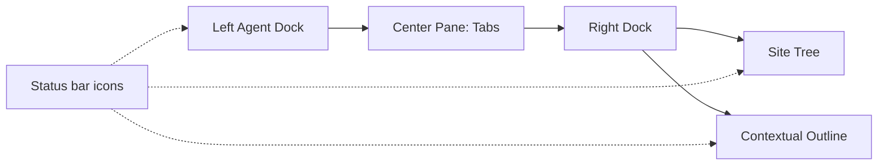
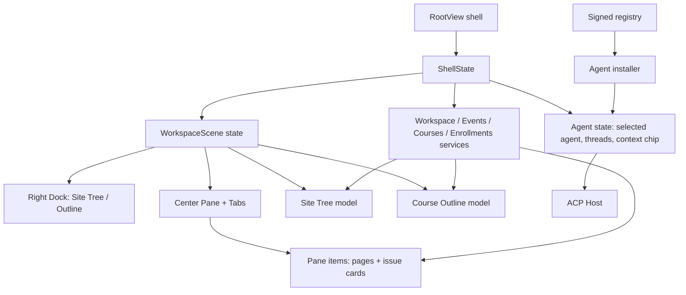

# Desktop Learning Navigation Workspace - Plan

## Goal Capsule

- **Objective:** 学员可以在一个窗口里完成“找内容 → 读卡片 → 问 agent”的完整学习循环：用 Site Tree 在应用里导航，用 Contextual Outline 在课程里切换 issue 卡，中间用 Tabs 保留多个页面，左侧用自己已安装的 agent 学习。
- **Means:** 采用 Zed 式 Dock/Pane 模型：左侧 Agent Dock；中间 Pane + Tabs；右侧一个 Dock 放 Site Tree 与 Contextual Outline 两个互斥 panel，底部用两个独立图标切换；Agent Registry 作为中心 Pane 的一个 tab 打开。
- **Authority:** 2026-10-20 对话中用户确认的产品决策：完整一期；两个右栏 panel 互斥；Site Tree 是完整数据实例树；懒加载、搜索、记忆；所有叶子开 tab；tabs 按 workspace 保留并重启恢复；未报名课程可见但锁定；Agent 全局跟随 active tab；Registry v1 只安装 Codex/Claude Code，OMP 作为 BYO native agent 保留在运行/选择路径。
- **Execution profile:** 一个端到端特性，按可独立验收的切片推进：导航壳与面板 → Site Tree/Outline → Tabs 与恢复 → Agent Panel/Registry → 安装流程与验收。
- **Open blockers:** 无阻塞需求确认；OMP 的安装来源不由客户端提供（2026-10-21 决策：OMP 移出 v1 Registry，仅作为用户自装 native agent 检测/启动）；OpenCode 的 ACP 安装包与校验和尚未验证，第一版不承诺其安装。

---

## Product Contract

### Summary

把课程学习页升级为三栏学习工作区：左侧 Agent、中间 Pane/Tabs、右侧 Site Tree 与 Contextual Outline。Site Tree 覆盖整个应用导航，Outline 专注当前课程；所有页面和 issue 卡都能在中间开 tab，agent 始终围绕当前 active tab 工作。

### Problem Frame

现在课程学习只有单页：所有 issue 材料平铺在一条长页面里，切换卡片要滚动；活动、课程、学习、参与各自是独立入口；agent 栏固定在右侧且只带课程上下文，无法围绕正在读的卡片工作。学员在“读内容、找下一页、问 agent”之间反复丢失位置。

当 Site Tree、Outline、Tabs 和 Agent 在同一个窗口里协同后，学员可以像用编辑器一样学习：从全局导航进入任何页面，在课程里切换到任意 issue 卡，把多个内容并排保留，并让 agent 知道当前在看哪张卡。

### Key Decisions

- **Site Tree 是完整数据实例树，不是路由模板树。** 没有实例的页面才显示 section 根节点。 (session-settled: user-directed — chosen over 路由模板树/仅当前 section：用户要求整个应用像 Project Panel 一样可导航。) Governs R6, R7, R9.
- **Site Tree 懒加载、可搜索、记忆展开位置。** 完整树必须在大数据量下仍然可用。 (session-settled: user-directed — chosen over 全量加载/分页加载更多。) Governs R8, R11.
- **右侧用同一个 Dock 的两个互斥 panel，不用两个 Tab。** 复刻 Zed 的 Dock + panel 图标模型。 (session-settled: user-directed — chosen over 两个右栏并排/右栏文本 Tab。) Governs R1–R5.
- **所有 Site Tree 叶子都在中心 Pane 开 Tab。** 导航行为统一，重复打开聚焦已有 tab。 (session-settled: user-directed — chosen over 仅 issue 卡开 tab/列表单页。) Governs R16, R17.
- **Tabs 按 workspace 保留并在重启后恢复。** 失效或无权限的 tab 在恢复时清理并提示。 (session-settled: user-directed — chosen over 仅本次运行/全局共享：用户选择按 workspace 持久化。) Governs R18, R19, R30, R31.
- **Agent Panel 在左侧且全局；active tab 作为可见上下文芯片。** 切 tab 不重建线程；芯片可手动移除。 (session-settled: user-directed — chosen over 每 tab 独立线程/纯手动挂上下文。) Governs R21, R27.
- **未报名课程保留在 Site Tree，但不可展开 outline。** 显示未报名/锁定标记，点击打开课程详情。 (session-settled: user-directed — chosen over 隐藏未报名课程/允许展开全部。) Governs R9, R14.
- **Registry v1 只一键安装 Codex/Claude Code。** OMP 是 native/BYO，保留在 Agent 选择与运行路径，但不出现在 Registry 安装列表；OpenCode 验证后再加入。 (session-settled: user-directed — 2026-10-21 用户选择 v1 移除 OMP：官方 OMP 安装是 curl/native，当前签名 manifest 没有安装来源，不能诚实地“一键安装”。) Governs R24–R26.
- **面包屑负责“我在哪”，Site Tree 负责“我能去哪”。** 面包屑跟随 active tab，不与 Site Tree 重复承担导航职责。 (session-settled: user-approved — 用户在 scoping synthesis 确认该分工。) Governs R29.
- **Agent 安装只来自内置签名清单。** 官方 ACP registry 只作发现层，未验证条目不能进入安装按钮。 (session-settled: user-approved — 沿用 ADR-0026 信任模型；2026-10-21 用户确认 v1 移除 OMP 安装项。) Governs R25.

### Actors

- A1. 学员：在课程/活动里学习，自己选择本机 agent。
- A2. 学员本机的 ACP agent：OMP、Codex、Claude Code 等，沿用学员自己的登录与模型额度。
- A3. CGC 平台：课程内容、活动、学习状态、workspace 权限的唯一来源。
- A4. CGC 签名 agent 清单与安装器：决定哪些 agent 可见、可安装、可启动。

### Requirements

**Layout and panels**

- R1. 课程学习页是三栏：左 Agent Dock、中 Pane、右 panel Dock；中心 Pane 始终保留可用宽度。
- R2. 右侧 Dock 同时承载 Site Tree 与 Contextual Outline 两个 panel；同一时间只显示一个，点另一个切换，点当前激活图标收起 Dock。
- R3. 底部状态栏为 Site Tree 与 Contextual Outline 各提供一个独立图标；图标显示对应 panel 是否打开，不出现文本 Tab。
- R4. 右侧 Dock 宽度可调整并在本次安装内记住；窄窗口下不能把中心内容压到不可用。
- R5. 左 Agent Dock 可收起/展开；展开时不替换中心 Pane，也不与右侧 panel 共享 Dock。

**Site Tree**

- R6. Site Tree 根是当前 workspace，顶层 section 至少包含概览、活动、课程、我的学习、我的参与；新增页面可以追加 section 或节点而不改变整体结构。
- R7. Site Tree 展示数据实例：活动 section 包含活动列表入口与具体活动节点；课程 section 包含课程目录入口与具体课程节点；课程节点展开后显示章节与 issue 卡。
- R8. 未展开的 section 不加载全量数据；展开、搜索或恢复位置时才加载；树顶提供搜索；展开状态与滚动位置按 workspace 记忆。
- R9. Site Tree 只展示学员有权看到的节点；未报名但可见的课程显示未报名/锁定标记，点击只开课程详情，不展示 outline。
- R10. 单击叶子打开/激活 tab；展开箭头的点击不导航；active tab 对应节点高亮，且展开父节点以露出该节点。
- R11. Site Tree 的展开状态、搜索词与滚动位置在切回 workspace 后恢复。

**Contextual Outline**

- R12. Outline 只显示当前课程的章节与 issue 卡，按章节分组；无章节的卡进入“未分组”。
- R13. 当前 active issue 卡在 Outline 中高亮；进度、下一步或完成状态来自平台学习状态。
- R14. 点击 issue 卡打开/激活 tab；Outline 中不展示未报名课程的卡目录，改为报名引导。
- R15. 进入课程学习时右侧默认切到 Outline；离开课程后保留用户上次选中的右侧 panel。

**Pane and Tabs**

- R16. 活动列表、活动详情、课程目录、课程详情、issue 卡、我的学习、我的参与等 Site Tree 叶子都在中心 Pane 以 Tab 打开。
- R17. 同一资源只保留一个 Tab；重复打开聚焦已有 Tab；关闭 active Tab 后激活相邻 Tab，没有相邻则回到该 section 的列表页或空态。
- R18. 每个 workspace 有独立 Tab 集；切换 workspace 换 tab 集；重启后恢复上次各 workspace 的 tab 集。
- R19. 恢复时发现资源已删除、无权限或课程 outline 不再可用，清理对应 Tab 并给出一次可见提示。
- R20. active Tab 决定面包屑标题、Outline 高亮和 Agent 的 active 上下文。

**Agent Panel**

- R21. 左侧 Agent Panel 是全局的；同一时间只显示一个 active thread；切换 tab 不重建 thread。
- R22. Agent Panel 的 `+` 菜单列出本机已安装且可用的 agent；选择一个 agent 新建 thread；没有可用 agent 时显示安装入口。
- R23. `Add More Agents` 在中心 Pane 打开或复用 Agent Registry tab，不使用弹窗。
- R24. Agent Registry 页面展示可安装/已安装状态、版本、登录或不可用原因；支持搜索与 All/Installed/Not installed 过滤。
- R25. Registry 的安装按钮只对签名清单中的 npx 条目出现；安装过程显示进度、成功、失败和重试；未验证条目只显示说明，不提供安装。
- R26. 第一版 Registry 包含 Codex、Claude Code；OMP 作为 BYO native agent 保留在 Agent 选择器，但不出现为可安装项；OpenCode 未验证前不得作为可安装项出现。
- R27. active Tab 作为上下文芯片显示在 Agent Panel；学员可移除芯片；切 tab 时芯片更新但不自动新建 thread。
- R28. 无可用 agent、agent 未登录、启动失败、安装失败都必须给出可执行的下一步，不只显示错误。

**Navigation and state**

- R29. 面包屑跟随 active Tab；Site Tree 导航到页面时更新 active Tab，而不是同时改变右侧 panel。
- R30. 切换 workspace 会切换 Site Tree 数据、Tab 集和 agent thread 作用域；不同 workspace 的内容不得混在同一个导航树或 Tab 里。
- R31. 学员从 Site Tree 打开页面、切换 Tab、切换 workspace 时，不丢失当前 Pane 的打开状态；只有显式关闭或资源失效才移除 Tab。

### Key Flows

- F1. 第一次进入课程学习
  - **Trigger:** 学员从 Site Tree 的课程节点进入已报名课程。
  - **Steps:** 右栏切到 Outline → 学员点 issue 卡 → 中心 Pane 打开该卡 tab → 左栏 agent 显示当前卡上下文芯片。
  - **Outcome:** 学员不离开课程就完成了“看目录 → 读卡 → 问 agent”。
  - **Covers R12, R14, R16, R20, R27.**
- F2. 多卡学习与切换
  - **Trigger:** 学员连续打开 3 张 issue 卡。
  - **Steps:** 每次打开新增/激活 tab → Outline 跟随 active tab 高亮 → Agent 上下文芯片同步更新 → 学员可以来回切 tab 而不重新加载目录。
  - **Outcome:** 学员可以对照多张卡学习，agent 始终知道当前卡。
  - **Covers R10, R13, R17, R20, R27.**
- F3. 用 Site Tree 浏览活动
  - **Trigger:** 学员在课程学习时想看活动。
  - **Steps:** 切到 Site Tree → 展开活动 → 点击具体活动 → 中心打开活动详情 tab → 切回课程卡 tab。
  - **Outcome:** 活动与课程在同一个 Pane 中共存，不丢课程上下文。
  - **Covers R7, R10, R16, R17, R29.**
- F4. 第一次安装 agent
  - **Trigger:** 学员点 `+` 或 `Add More Agents`，本机没有可用 agent。
  - **Steps:** 打开/复用 Agent Registry tab → 选择已验证 agent → 安装并显示进度 → 成功后回到 Agent Panel 新建 thread。
  - **Outcome:** 学员不离开应用、不查外部文档就完成 agent 安装。
  - **Covers R21–R26, R28.**
- F5. 切换 workspace 与重启
  - **Trigger:** 学员切到另一个 workspace，或第二天重新打开应用。
  - **Steps:** 切换时换 Site Tree 与 tab 集 → 恢复时按 workspace 还原 tab；失效 tab 被清理并提示。
  - **Outcome:** 学员回到上次的阅读位置，但不会跨 workspace 串内容。
  - **Covers R18, R19, R30, R31.**

### Acceptance Examples

- AE1. 右栏两个图标：点 Site Tree 图标只显示 Site Tree；点 Outline 图标只显示 Outline；再点当前图标收起右栏。**Covers R2, R3.**
- AE2. 完整树：活动 section 未展开时不请求全部活动；展开后显示实例；搜索“HITL”只显示匹配节点；切走再回来，展开与滚动位置保留。**Covers R8, R11.**
- AE3. 未报名课程：课程出现在树中并带未报名标记；点击只打开课程详情，展开不显示章节/卡；报名后重新进入才出现 Outline。**Covers R9, R14.**
- AE4. Tabs：从树打开活动详情、课程详情和 issue 卡，得到 3 个 tab；重复打开同一 issue 不新增 tab；关闭 active tab 后相邻 tab 激活。**Covers R16, R17.**
- AE5. 重启恢复：打开 2 个 tab 后重启，两个 tab 恢复；切到另一个 workspace 后看到另一套 tab；删除资源的 tab 被清理并提示。**Covers R18, R19, R30.**
- AE6. Agent 上下文：从卡 A 切到卡 B，agent 芯片从 A 更新为 B；手动移除芯片后不再自动加回；切 tab 不重建 thread。**Covers R20, R27.**
- AE7. 无 agent：本机没有安装任何 agent 时，`+` 菜单给安装入口；`Add More Agents` 打开 Registry tab；安装 Codex 或 Claude Code 后能新建 thread；OMP 若已由用户自装则出现在 Agent 选择器，但不在 Registry 安装列表。**Covers R22–R26, R28.**
- AE8. 授权变化：未报名课程变为可报名后 Outline 可用；失去 workspace 权限时对应 tree、tab 和 thread 不再展示。**Covers R9, R19, R30.**

### Success Criteria

- 学员可以在一个窗口内完成“从 Site Tree 找课程 → 打开 3 张卡 → 在 tab 间切换 → 向 agent 提问”，全程不回列表页。
- Site Tree 与 Outline 的图标/面板状态一眼可辨；右栏同一时间只有一个 panel，中心 Pane 不被压到不可用。
- 2 个可安装 agent（Codex、Claude Code）可以从 Registry 安装并开始 thread；OMP 自装用户能在 Agent 选择器看到它；无 agent 的学员不会卡在空白或不可解释的错误。
- Tabs 按 workspace 恢复，失效资源有提示；不出现跨 workspace 混用或未授权课程 outline。

### Scope Boundaries

**Deferred for later**

- Preview tabs、pin、拖拽重排 Tab。
- Agent 之间的上下文迁移、跨 agent thread 合并。
- OpenCode 的签名安装条目，直到 ACP 包、版本、校验和验证完成。
- 跨设备同步 tabs、跨设备恢复 agent thread。
- 自定义快捷键、Tab 快捷键完整映射。
- Agent 安装的卸载、回滚与多版本共存。

**Not building**

- 课程内容编辑/教研工作台。
- 在中心 Pane 内编辑 issue 内容或提交作业的新写流程。
- 管理后台、Flashback、Initiatives、活动报名后台等非学员页面。
- 自动迁移历史 agent 会话到新 tab 上下文。

### Dependencies / Assumptions

- 课程内容已具备 chapters、issues、`chapter_id`、story/objective 元数据；桌面端当前解析器会丢弃这些字段，实施时必须先补齐消费面。
- 内置签名 agent 清单当前包含 OMP、Codex、Claude Code；v1 Registry 只把 npx 的 Codex/Claude Code 作为可安装项，OMP 仅作 native 检测/启动；`opencode` 不在清单内。
- Agent 一键安装当前只实现 npx 预热/验证；OMP 的 native 安装来源不在签名 manifest 内，因此不提供客户端安装。
- 当前 Desktop 是单页路由 + 固定右 Agent 栏，没有 Pane/Tab/Dock 模型；三栏与多 tab 是净新增壳层。
- Agent 当前上下文只到 course 级，未到 issue 卡；active tab 上下文需要扩展 ACP 上下文下发。
- 各 agent 在 macOS/Windows/Linux 的安装方式、登录方式和 ACP 兼容性需要在实施前逐项验证；第一版安装只在验证通过的平台开放。

### Outstanding Questions

- `Resolve Before Planning`：无。OpenCode 已明确排除在第一版安装范围之外。
- `Deferred to Planning`：Codex/Claude Code 在 Windows/Linux 的安装与登录流程是否同构；如果不同构，按平台降级而不是阻塞 macOS。
- `Deferred to Planning`：Tab 的预览/pin/关闭快捷键是否在第一版后立即补；本计划只要求常驻 Tab。

### Sources / Research

- 现有课程内容模型：`desktop/crates/courses/src/content.rs`、`backend/lib/cgc_2046/curriculum/content.ex`、`backend/lib/cgc_2046/courses/course_projection.ex`。
- 当前 Desktop 壳与路由：`desktop/crates/app/src/root_view.rs`、`desktop/crates/app/src/root_view/screens/courses/learning.rs`、`desktop/crates/courses/src/registration.rs`。
- 当前 Agent 与 Registry：`desktop/crates/platform/src/registry/{manifest,discovery,mod}.rs`、`desktop/crates/platform/resources/registry.json`、`desktop/crates/app/src/root_view/controller.rs`。
- Prior plans：`docs/plans/2026-10-14-1446-feat-course-page-local-agent-chat-plan.md`、`docs/plans/2026-10-17-1139-feat-multi-local-agent-selection-plan.md`。
- ADRs：`docs/adr/0022-course-page-local-agent-host.md`、`docs/adr/0023-multiple-local-agents.md`、`docs/adr/0026-agent-mcp-registry-trust.md`、`docs/adr/0027-desktop-release-and-signing.md`。
- Zed upstream research：Dock 多 panel + active panel、PanelButtons 状态栏图标、Agent `+` 菜单与 `AcpRegistry` 中心 Pane 页。

---

## Planning Contract

### Key Technical Decisions

- KTD1. **RootView 继续做壳，workspace 场景作为 ShellState 的一个子状态。** 页面、Dock、Pane、Site Tree、Outline 的渲染放 `root_view/screens/workspace/`；加载、切换、持久化动作放 controller；不把新状态散回 RootView。 Governs R1–R5, R16–R20.
- KTD2. **Dock/Pane 自建，不假设 gpui-kit 提供 Zed 同款组件。** 复用现有 `div` 布局与主题 token，实现两个 panel 的互斥 Dock、可调整宽度、图标按钮和 Pane TabBar；先用最小交互，不引入拖拽面板。 Governs R1–R5, R16–R20.
- KTD3. **Course Outline 的数据源是现有 `courseContent`，不新增后端课程模型。** 扩展桌面解析器消费 `chapter_id`、story/objective 元数据与 material URL；后端已有章节校验与 issue 结构。 Governs R12–R15.
- KTD4. **Pane item 用稳定资源键标识，Tabs 状态按 workspace 持久化。** 键为 workspace + 资源类型 + 资源 id；不持久化临时滚动位置之外的内容；失效资源在恢复时清理。 Governs R16–R20, R29–R31.
- KTD5. **Site Tree 用现有 workspace/events/courses/enrollments 服务组装，按需加载。** 不新增后端“树”接口；section 展开时调用对应列表服务，搜索在已加载节点上过滤，必要时再拉当前 section。 Governs R6–R11.
- KTD6. **Agent Panel 继续用现有 ACP Host，增加显式 agent 选择与 active tab 上下文。** `ChatUi` 增加 selected agent 与上下文芯片；thread 仍按 course/agent 维护，切 tab 不重建 host；没有可用 agent 时进入安装路径。 Governs R21–R28.
- KTD7. **Agent 一键安装是新实现，不是接现有安装器。** `registry/install.rs` 当前只有接口注释；需实现 native/npx 分发、Node runtime 复用、进度/失败事件、签名校验与检测；只允许内置清单条目。 Governs R24–R26.
- KTD8. **用可替换 seam 隔离外部副作用。** Site Tree loader、Agent detector/installer、ACP host 都通过 trait/fake 注入；单测不下载、不启动真实 agent，HITL 才跑真实链路。 Governs R8, R24–R26.

### High-Level Technical Design

### Implementation Units

- U1. Course content and outline model
  - **Goal:** 解析器保留章节、issue 关系、objective 元数据与 material 地址；提供确定性的章节分组模型与未分组兜底。
  - **Files:** `desktop/crates/courses/src/content.rs`、`desktop/crates/courses/src/outline.rs`（新增）、对应测试。
  - **Pattern:** 继续 fail-soft 解析；未知材质降级；不 panic。
  - **Tests:** 带 `chapter_id` 的 issue 归组；缺失/非法 `chapter_id` 进未分组；web/image/video 的 url/alt/provider/external_id 保留；空章节与重复 chapter id 行为固定。
  - **Verification:** `cargo test -p cgc-courses`；用真实 `courseContent` 样本做一次解析快照。
- U2. Workspace scene shell and right Dock
  - **Goal:** 课程学习页呈现左 Agent、中 Pane、右 Dock；右 Dock 两个 panel 互斥，底部图标可切换/收起；宽度可拖动并记住。
  - **Files:** `desktop/crates/app/src/root_view.rs`、`root_view/state.rs`、`root_view/controller.rs`、`root_view/screens/workspace/dock.rs`（新增）、`root_view/screens/workspace/mod.rs`。
  - **Pattern:** 复用 theme token 与现有 ScreenContext；RootView 只做路由调用；panel 状态放 ShellState。
  - **Tests:** state tests for panel switch/collapse/width clamp；HITL 截图验证三栏与两个图标。
  - **Verification:** `cargo test -p cgc-desktop-app` + HITL。
- U3. Site Tree model and panel
  - **Goal:** 展示当前 workspace、section 根、活动/课程实例；懒加载、搜索、展开位置与滚动位置按 workspace 记忆；未报名课程带锁定标记。
  - **Files:** `root_view/screens/workspace/site_tree.rs`（新增）、state/controller 的 loader；必要时扩展现有服务聚合方法。
  - **Pattern:** loader 返回分页/可取消结果；树模型不直接发请求；权限过滤在数据层完成。
  - **Tests:** section 根、未展开不加载、展开加载、搜索过滤、未报名标记、workspace 切换清理、恢复展开位置。
  - **Verification:** `cargo test -p cgc-desktop-app`；HITL 用多个活动/课程数据。
- U4. Contextual Outline panel
  - **Goal:** 当前课程按章节列出 issue 卡，active 卡高亮；未报名课程显示报名引导。
  - **Files:** `root_view/screens/workspace/outline.rs`（新增）、U1 的 outline model、learning projection。
  - **Pattern:** 纯渲染模型；点击只派发 Pane 打开动作。
  - **Tests:** 章节分组、未分组、空课程、未报名、active 卡随 tab 更新。
  - **Verification:** HITL 对照真实课程章节。
- U5. Pane, Tabs, and persistence
  - **Goal:** Site Tree 所有叶子在中心打开 Tab；重复打开聚焦；关闭后激活相邻；active tab 更新面包屑/outline/agent chip；每 workspace 恢复。
  - **Files:** `root_view/screens/workspace/pane.rs`、`tabs.rs`（新增）、`root_view/state.rs`、`controller.rs`、持久化模块。
  - **Pattern:** item identity 用稳定资源键；持久化只存 id/顺序/active；恢复时再解析资源。
  - **Tests:** 打开/去重/关闭/相邻/空态；workspace 切换；重启恢复；失效清理；active tab 联动。
  - **Verification:** `cargo test` + HITL 重启应用。
- U6. Agent Panel left, picker, and active context
  - **Goal:** Agent 在左；`+` 列出已安装 agent；选择后新建 thread；active tab 作为可移除上下文芯片；thread 不因切 tab 重建。
  - **Files:** `root_view/screens/chat/{dock,panel}.rs`、`root_view/state.rs`、`controller.rs`、`platform/agent/*`。
  - **Pattern:** selected agent 显式保存；chat session key 包含 agent/course；ACP host 继续由 controller 持有。
  - **Tests:** installed/missing/outdated 菜单；选择/切换 agent；上下文芯片增删；切 tab 不重建；启动失败提示。
  - **Verification:** HITL 用 OMP/Codex 真实安装与未安装两种环境。
- U7. Agent Registry page and installer
  - **Goal:** `Add More Agents` 打开/复用中心 Registry tab；列出 Codex/Claude Code 两个可安装 npx agent；OMP 仍可在 Agent 选择器检测/启动但不进 Registry；安装失败可重试；OpenCode 不出现为可安装项。
  - **Files:** `root_view/screens/workspace/agent_registry.rs`（新增）、`platform/registry/install.rs`（实现）、`platform/registry/manifest.rs` 消费、相关资源签名。
  - **Pattern:** installer 只接受 `Registry::builtin()` 条目；native/npx 两种分发；Node runtime 复用；所有副作用可取消/报错；不读第三方凭证。
  - **Tests:** fake installer 成功/失败/取消；签名失败 fail-closed；未安装→安装→检测；OMP/OpenCode 不在安装列表；Registry 页面搜索/过滤。
  - **Verification:** `cargo test -p cgc-platform`；HITL 在干净用户目录安装一次（不提交凭证）。
- U8. Acceptance and regression
  - **Goal:** 用 HITL 覆盖 F1–F5 与 AE1–AE8；补关键状态测试；产出验收截图与缺口清单。
  - **Files:** 测试文件、`_bmad-output/initiative-desktop/tickets/.../evidence/`（按项目既有验收目录）。
  - **Pattern:** 端到端优先；UI 截图作为证据；真实 agent 安装只在隔离测试账号/目录。
  - **Verification:** `cargo fmt --check`、`cargo clippy --workspace --all-targets -- -D warnings`、`cargo test --workspace`、release build + HITL。

### Risks and Rollback

- **Tree scale:** 完整实例树在活动/课程多时可能拖慢首屏；U3 的懒加载与缓存必须有上限，超过阈值只保留 section 根与最近节点。
- **Installer supply chain:** 一键安装新增下载/执行面；只允许签名清单、固定版本与校验和；任何校验失败 fail-closed，不降级到官方 registry。
- **Agent context leakage:** active tab 自动进入 agent 上下文；必须显示芯片、允许移除，且不把未授权内容送入 agent。
- **Layout fragility:** 三栏在窄窗口可能挤压中心；U2 必须有宽度下限与折叠策略，HITL 覆盖 1280/1440/1024。
- **Rollback:** 不新增数据库 schema；回滚代码即可恢复旧单页。若 Tabs 恢复文件已写入，可忽略该文件；不迁移课程/agent 数据。

### Verification Contract

| 检查 | 命令/动作 | 通过条件 |
|---|---|---|
| 格式 | `cd desktop && cargo fmt --all --check` | 无 diff |
| 静态检查 | `cd desktop && cargo clippy --workspace --all-targets -- -D warnings` | 0 error |
| 单测 | `cd desktop && cargo test --workspace` | 全绿；新增 U1–U7 测试 |
| 构建 | `cd desktop && cargo build --release -p cgc-desktop-app` | 成功 |
| HITL 布局 | 打开课程学习页，点右栏两个图标 | 三栏、互斥、宽度可调、无重叠 |
| HITL 树 | 展开活动/课程、搜索、切 workspace、重启 | 懒加载、锁定标记、恢复位置 |
| HITL Tabs | 打开活动/课程/issue 多 tab、关闭、重启 | 去重、相邻激活、恢复/清理 |
| HITL Agent | `+` 菜单、选择 agent、切 tab | 上下文芯片更新、thread 不重建 |
| HITL Registry | 安装 Codex/Claude Code、失败/重试 | 进度可见、签名失败不安装、OMP/OpenCode 不可安装 |
| 权限 | 未报名课程、失去 workspace 权限 | 不展开 outline、不显示未授权内容 |

### Definition of Done

- R1–R31 全部有实现或明确标记为不适用；没有未分类的 `Resolve Before Planning`。
- U1–U8 的测试与 HITL 验收通过；`cargo fmt`、`clippy`、`test`、release build 全绿。
- 右栏两个 panel 互斥且底部两个图标可用；Site Tree 能导航活动/课程/issue；Tabs 按 workspace 恢复；Agent 左移并带 active tab 上下文。
- 真实安装仅使用签名清单；OpenCode 未验证前不出现在可安装列表。
- 变更可回滚：无数据库迁移，回滚代码即恢复旧单页；本地 Tabs 恢复文件可安全忽略。

