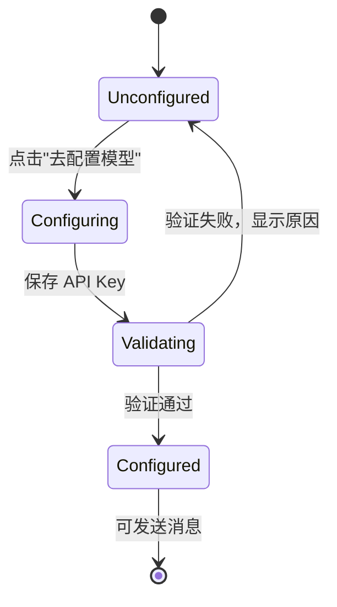

# Desktop 首次登录模型配置 Onboarding - Plan

## Goal Capsule

- **Objective:** 真实小白学员首次登录桌面客户端后，能看懂"还没有接模型"，并按一条明确路径完成 DeepSeek 接入，顺利发出第一条消息。
- **Product authority:** 用户（product owner）于 2026-10-29 确认：目标用户为真实小白学员；CGC 网关不在本轮；未配置模型时 composer 禁用并引导配置；Echo 仅 demo/dev 可用。
- **Open blockers:** None.

## Product Contract

### Summary

为桌面客户端的首个模型接入补上 onboarding：未配置模型时，Agent Panel 明确说明当前未连接模型，给出 Settings → AI → LLM Providers 的配置路径和 DeepSeek API Key 获取入口。用户在 Settings 保存 Key 时验证连通性，验证通过后回到面板无需重启即可发送。生产构建不再显示 Echo，Echo 只在 demo/dev 模式使用。

### Problem Frame

真实小白学员从 GitHub Release 安装客户端并用微信登录后，Agent Panel 直接显示 `Ask echo`。这不是一个可用模型，而是离线回显兜底；用户既不知道"还没配置模型"，也不知道下一步该去哪里。现有配置入口埋在 Settings → AI → LLM Providers，保存 Key 后还要重启客户端才生效，最关键的首次对话在第一步就断了。发布说明也只讲下载、安装与校验，没有提示需要先接入模型。

### Actors

- A1. 学员：首次使用客户端、没有现成模型配置的真实小白用户。
- A2. Settings 配置页：学员完成 Provider 与 API Key 配置的界面。
- A3. Agent Panel：显示未配置状态、承载首次对话的界面。

### Requirements

**未配置状态**

- R1. 生产构建在没有任何可用 Provider 或 API Key 时，Agent Panel 的 composer 保持可见但禁止发送；输入框 placeholder/空态必须说明当前未连接模型。
- R2. 未配置状态必须给出一条可执行的配置路径（Settings → AI → LLM Providers），并提供"去配置模型"动作；点击后直接打开 Settings 窗口的 AI → LLM Providers 页面。
- R3. 未配置状态必须把 DeepSeek 标为推荐 Provider，并提供获取 DeepSeek API Key 的官方入口。
- R4. 生产构建的模型选择器不得把 Echo 或任何离线回显呈现为可选模型；未配置时也不得展示可点击的假模型。
- R5. Onboarding 路径不得把 CGC 账号托管模型的占位项呈现为可用选项，也不得把用户导向该占位卡。

**配置与生效**

- R6. 保存 Provider API Key 时，必须先完成一次连通性验证，验证通过后才把该 Provider 标记为可用。
- R7. 在首版 DeepSeek onboarding 路径中，验证通过后用户返回 Agent Panel 无需重启客户端即可发送消息；未另行选择模型时，模型自动落到 `deepseek-flash`。
- R8. 验证失败时，界面必须给出用户能理解的原因（认证、网络或额度），保持未配置状态，并提供重试入口。
- R9. 已有可用 Provider 与 API Key 的用户保持现有行为，不重复进入 onboarding。

**Echo 与 demo/dev**

- R10. 生产构建中，Echo 不作为用户可达的回退路径；未配置时不得产生任何离线回显回复。
- R11. 仅 demo/dev 模式可显示并使用 Echo；该模式下界面必须明确标识为演示状态。

### Key Decisions

- KD1. **首版只做 BYOK DeepSeek，不做 CGC 账号托管模型。** (session-settled: user-directed — chosen over CGC gateway provisioning: gateway is not ready this round.) Governs R1-R3, R6-R9.
- KD2. **未配置时禁用发送，而不是允许发送后报错。** (session-settled: user-directed — chosen over allowing send then erroring: the path must be visible before the first message.) Governs R1.
- KD3. **配置入口复用 Settings → AI → LLM Providers，不内嵌 Agent Panel 表单，也不新增独立向导。** (session-settled: user-directed — chosen over an inline Agent Panel form and a standalone onboarding wizard: reuse the existing Settings page with the smallest scope.) Governs R2, R6.
- KD4. **保存 API Key 时做连通性验证。** (session-settled: user-directed — chosen over save-without-validation: beginners need immediate feedback before their first send.) Governs R6-R8.
- KD5. **Echo 只在 demo/dev 出现。** (session-settled: user-directed — chosen over a production Echo fallback: real users must not see a fake model.) Governs R4, R10, R11.

### Key Flows

- F1. 首次配置与首次对话
  - **Trigger:** 学员首次登录，Agent Panel 没有可用的 Provider/API Key。
  - **Actors:** A1, A2, A3.
  - **Steps:** Agent Panel 显示未配置状态和配置路径；学员点击"去配置模型"进入 Settings → AI → LLM Providers；在 DeepSeek 行填入 API Key 并保存；系统验证连通性；验证通过后学员返回 Agent Panel；composer 解除禁用，模型为 `deepseek-flash`；学员发送第一条消息。
  - **Outcome:** 学员不重启客户端就完成首次成功对话。
  - **Covers:** R1-R7, R9.
- F2. 验证失败与重试
  - **Trigger:** 学员保存的 API Key 无法通过连通性验证。
  - **Actors:** A1, A2, A3.
  - **Steps:** 设置页显示可读的失败原因；Provider 保持未配置；学员修正 Key 后重试；验证通过后回到 F1 的生效步骤。
  - **Outcome:** 学员知道失败原因并能继续配置，不会进入无法发送的假成功状态。
  - **Covers:** R6, R8.
- F3. Demo/dev 演示
  - **Trigger:** 以 demo/dev 模式启动客户端且没有真实 Provider。
  - **Actors:** A1, A3.
  - **Steps:** Agent Panel 显示 Echo 为演示模型；学员可以发送并收到离线回显；界面明确标识演示状态。
  - **Outcome:** 开发与回归可以在无模型凭据下操作 UI。
  - **Covers:** R11.

### Acceptance Examples

- AE1. **首次登录、生产构建、无 Provider** — **Covers R1-R5, R10.** 给定学员首次登录且本机没有任何可用 Provider/API Key，当 Agent Panel 打开时，composer 可见但发送不可用，placeholder/空态包含 Settings → AI → LLM Providers 与 DeepSeek API Key 获取入口，模型选择器不出现 Echo。
- AE2. **从空态进入配置页** — **Covers R2.** 给定 Agent Panel 处于未配置状态，当学员点击"去配置模型"时，Settings 窗口打开并落在 AI → LLM Providers 页面，页面中可见 DeepSeek 的 Key 输入。
- AE3. **有效 Key 首次生效** — **Covers R6, R7.** 给定学员在 DeepSeek 行填入有效 API Key 并保存，当连通性验证通过并返回 Agent Panel 时，composer 无需重启即可发送，模型为 `deepseek-flash`，首条消息得到真实模型回复而不是 `（离线 demo）收到`。
- AE4. **无效 Key** — **Covers R8.** 给定学员填入无效 API Key，当保存并验证失败时，页面显示可读的失败原因，Provider 仍为未配置，学员可以修改 Key 后重试。
- AE5. **已有配置用户** — **Covers R9.** 给定学员已有一个可用 Provider 与 API Key，当打开 Agent Panel 时，composer 正常可用，模型选择保持原状，不出现 onboarding 空态。
- AE6. **Demo/dev** — **Covers R11.** 给定客户端以 demo/dev 模式启动且无真实 Provider，当打开 Agent Panel 时，Echo 可见并可发送离线回显；生产构建不出现该状态。

### Success Criteria

- SC1. 生产构建首次登录且无配置时，Agent Panel 不出现 Echo；composer 不可发送，配置路径与 DeepSeek Key 获取入口同时可见。
- SC2. 一名没有模型配置经验的新用户可以在不重启客户端的情况下，从 Agent Panel 空态走到首条成功消息；至少在 macOS 与 Windows 真机各验证一次。
- SC3. 生产构建的任何对话都不会出现 `（离线 demo）收到`。
- SC4. 已有可用配置的用户行为不变；demo/dev 的 Echo 仍可用于 UI 回归。

### Scope Boundaries

**Deferred for later**

- CGC 账号托管模型、订阅额度与服务端计量。
- Agent Panel 内嵌 Provider 配置表单。
- 独立的登录后 onboarding 向导。
- DeepSeek 之外其他 Provider 的一键接入引导；其他内置 Provider 继续走 Settings 原有表单。
- 模型目录的远程增量更新。

**Outside this product's identity**

- External ACP agent 的安装、登录与模型配置。
- 账号计费与订阅体系。

### Dependencies / Assumptions

- Settings 窗口支持从 Agent Panel 直接打开并落在 AI → LLM Providers 页面；若现有路由不支持，由 planning 补齐。
- DeepSeek 提供可用的官方 API Key 获取页面，并提供轻量连通性验证方式。
- 需求中的 `CGC_AGENT_DEMO` 与代码库现有的 `CGC_NATIVE_AGENT_DEMO` 视为同一 demo/dev 语义；最终采用现有开关或加别名由 planning 决定。
- `has_key` 标记存在但系统钥匙串读不到真实 Key 时，按未配置处理。
- 生产构建默认运行在 prod 环境，不暴露任何 demo 入口。

### Outstanding Questions

**Resolve Before Planning**

- None.

**Deferred to Planning**

- placeholder/空态的最终文案与"去配置模型"按钮形态。
- 模型选择器在未配置时显示"未配置模型"还是整体隐藏。
- 打开 Settings AI 页的具体导航方式。
- 连通性验证的请求方式与超时、错误分类。
- CGC 网关占位卡是否需要在 onboarding 路径中临时隐藏。
- 多 Provider 已配置时，首次进入 onboarding 后默认选中哪个 Provider。

### Sources / Research

- `desktop/crates/app/src/native_runtime/factory.rs:47-151` — Provider 初始化与 Echo 回退。
- `desktop/crates/agent_provider/src/echo.rs:11-56` — EchoProvider 的离线回显行为。
- `desktop/crates/app/src/native_agent_view/panels.rs:206-254` — 模型 picker 的标签与 provider 来源。
- `desktop/crates/app/src/settings_window.rs:356-393, 1254-1293` — Provider Key 保存与 CGC 占位卡。
- `desktop/crates/agent_store/src/prefs.rs:125-133, 222-327` — 默认偏好与内置 Provider 目录。
- `desktop/crates/app/src/main.rs:76-77, 165-180` — demo 模式入口。
- `docs/adr/0028-desktop-native-agent-dual-track.md:47-54` — CGC 网关与 BYO Provider 决策。
- `docs/plans/2026-10-22-1500-feat-native-agent-design.md:374` — Provider 配置页与"保存后立即生效"的目标描述。
- `.github/workflows/desktop-release.yml:198-247` — 发布说明只覆盖下载、安装与校验。
