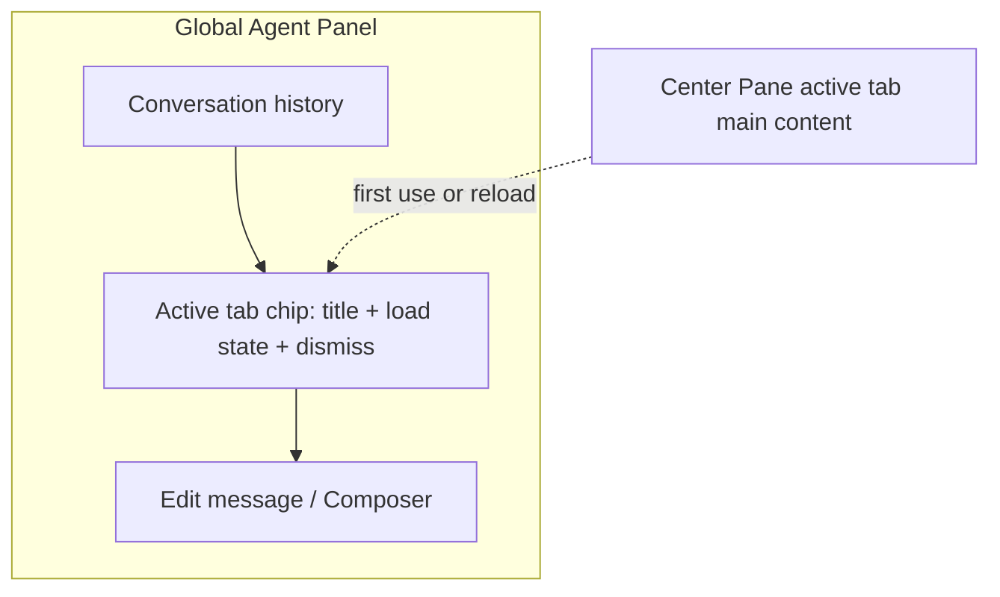
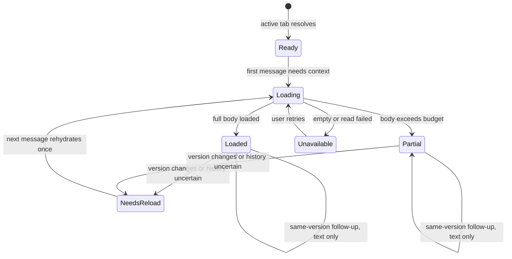

# Global Agent Active Tab Context - Plan

## Goal Capsule

- **Objective:** Desktop 学员可以在任意中心内容 tab 使用 Native 或 ACP Agent，围绕当前页面连续对话，并明确知道正文何时进入上下文；同一页面版本不在线程中重复发送全文。
- **Means:** 统一全局 Agent Panel 与 active tab 上下文契约，以 Composer 上方的可见 chip 表示加载状态，并按线程、Agent、tab 内容版本执行“首次加载一次，必要时重新加载”。
- **Authority:** 2026-10-30 对话确认的产品决策。当前工作只包含双 Agent 全局可用与 active tab 上下文；选中文字浮动添加、课程 Outline 内容化和 Native 独有客户端交互扩展不是本期范围。
- **Open blockers:** 无阻塞需求确认。

---

## Product Contract

### Summary

将 Native 与 ACP Agent 都开放到主窗口的所有中心内容 tab，并保留 Native 的独有能力。active tab 通过 Composer 上方的 chip 提供可见、可删除的正文上下文；全文按线程与内容版本只加载一次，后续追问依赖会话历史，无法确认历史可靠时再重新加载。

### Problem Frame

当前 ACP 对话入口仍受课程学习页限制，学员在其他内容页无法使用自己选择的 Agent。Native 虽然会接收部分课程元数据，但界面没有对应的可见上下文，学员难以判断 Agent 是否知道当前页面，也无法解释回答为何偏离正在阅读的内容。

如果把 active tab 全文简单附在每条消息后面，连续追问会反复传输相同内容。以同一 tab 对话 10 次为例，后 9 次重复全文只增加 token 成本，不提供新的上下文价值；但完全不重复发送又要求产品明确处理内容版本变化、会话压缩、历史恢复与 Agent 切换，否则界面状态和模型实际可见内容会脱节。

### Key Decisions

- **双 Agent 全局可用，能力不要求拉平。** Native 的独有能力继续存在，共享的是入口与上下文语义。 (session-settled: user-directed — chosen over ACP 仅课程页可用及强制两轨能力一致：全局可用不等于削弱 Native。) Governs R1–R3.
- **active tab 自动提供正文，而不是只提供页面引用。** 非课程页也必须能直接围绕当前内容回答。 (session-settled: user-directed — chosen over 只发页面引用：引用不足以支持非课程页的内容问答。) Governs R4–R9.
- **全文按线程加载一次，不随每条消息重复发送。** chip 表示当前关联与加载状态，不代表每次发送都重新传输全文。 (session-settled: user-directed — chosen over 每条消息重复携带全文：同一页面版本的连续追问不应重复消耗 token。) Governs R10–R16.
- **chip 固定在 Composer 上方并持续显示状态。** 上下文与用户正在编辑的正文保持可区分。 (session-settled: user-approved — chosen over 把上下文直接混入编辑正文：用户需要独立查看和删除上下文。) Governs R4–R9, R17–R18.
- **删除不等于遗忘。** 删除 chip 只停止后续自动关联，新建线程才提供不含旧页面正文的干净对话。 (session-settled: user-approved — chosen over 删除 chip 即清除已发送内容：已经进入会话历史的内容无法通过移除附件撤回。) Governs R17–R18.
- **课程 Outline 只是导航，不是自动上下文来源。** active tab 才决定自动关联哪份正文。 (session-settled: user-directed — chosen over 把课程 Outline 作为上下文来源：目录用于定位内容，不应整棵发送给 Agent。) Governs R19.
- **选中文字浮动添加后置。** 首版先完成全局入口与页面级上下文的最小完整闭环。 (session-settled: user-directed — chosen over 首版同时交付浮动选段：该能力可独立后续交付。)

### Actors

- A1. Desktop 学员：在中间 Pane 阅读内容、切换 tab、选择 Agent、管理上下文 chip 并发送消息。
- A2. Native CGC Agent：提供第一方运行时及 Native 独有的客户端能力。
- A3. External ACP Agent：由学员选择的外部 Agent，使用自己的会话与模型能力。
- A4. Desktop 客户端：协调 center Pane、active tab、正文版本、chip、线程与两轨消息提交。

### Requirements

**Global agent availability**

- R1. Native 与 ACP Agent 都必须能在主窗口的任意中心内容 tab 发起或继续对话，不再对 ACP 显示课程学习页专属的入口限制。
- R2. 切换 center Pane tab 不得重建当前 Agent 线程，学员选择的 Agent 与会话在页面切换前后保持连续。
- R3. Native 独有能力必须保留；共享全局入口与 active tab 上下文不得要求 ACP 获得相同的 Native 客户端能力。

**Visible context and body loading**

- R4. 当前 active 中心 tab 必须在 Composer 上方显示一个自动上下文 chip，包含页面标题与加载状态，inactive tab 不得同时显示自动 chip。
- R5. 自动上下文的正文范围只包含 active tab 的主内容，不包含 Site Tree、Outline、Agent Panel、其他 tab 或独立窗口内容。
- R6. chip 必须区分加载中、可加载、已完整加载、部分加载、需要重新加载、空正文与加载失败状态，并为失败提供重试入口。
- R7. active tab 的正文与页面标识必须在该 tab 首次用于当前线程的下一条消息中加载；仅打开或切换 tab 不得自行发起模型请求。
- R8. 正文超过当前 Agent 可容纳预算时，chip 必须明确显示部分加载及未完整包含，不得把截断后的内容表示为完整全文。
- R9. 正文未就绪或读取失败时不得静默按“已加载”处理，学员可以重试，或删除 chip 后仅发送文字。

**Load-once lifecycle**

- R10. 自动上下文的加载身份必须由当前线程、当前 Agent、tab 稳定标识与 tab 内容版本共同确定。
- R11. 同一加载身份的后续消息只发送用户输入，chip 仍须通过样式或文字明确显示“已在上下文中”。
- R12. 切换到当前线程尚未加载的 tab 时，下一条消息加载该 tab；切回相同版本的已加载 tab 时不得重复发送正文。
- R13. tab 内容版本变化后，下一条消息必须重新加载新版本一次；版本未变化不得因展开、滚动或重复聚焦而重新加载。
- R14. 新建线程或切换 Agent 必须形成新的加载身份，不得假设另一线程或另一 Agent 已持有该正文。
- R15. 客户端无法确认恢复历史或压缩后的会话仍保留完整正文时，chip 必须标为需要重新加载，并在下一条消息自动补发一次。
- R16. 每次提交必须冻结当时的 tab 标识、内容版本与实际加载载荷，已发送或已排队消息不得被后续切 tab 改写。

**Dismissal and navigation**

- R17. 学员可以删除当前自动 chip 并继续发送纯文本；删除只抑制当前 tab 的自动关联，切换 tab 后按 R12 重新自动关联。
- R18. 删除 chip 不得表示或暗示已清除历史中的正文，已经发送的内容仍属于当前线程；需要摆脱旧正文时必须新建线程。
- R19. 课程 Outline 只负责打开或激活 issue tab，不得把 Outline 自身或整门课程目录自动附加为上下文。

### Key Flows

- F1. 在非课程页第一次使用 ACP
  - **Trigger:** 学员打开一个非课程中心内容 tab，并选择 external ACP Agent。
  - **Actors:** A1, A3, A4
  - **Steps:** Agent Panel 保持可用 → chip 解析当前 tab → 学员发送第一条消息 → 当前 tab 正文随该消息加载。
  - **Outcome:** ACP 能围绕当前页面回答，不再要求学员回到课程学习页。
  - **Covers R1, R4–R7, R10.**
- F2. 同一 tab 连续对话 10 次
  - **Trigger:** 学员在同一 Agent 线程中围绕同一 tab、同一内容版本连续发送 10 条消息。
  - **Actors:** A1, A2 or A3, A4
  - **Steps:** 第 1 条消息加载正文 → 后 9 条消息只提交用户输入 → chip 持续显示已在上下文中。
  - **Outcome:** 会话保留页面上下文，但不重复传输相同全文。
  - **Covers R2, R10–R11, R16.**
- F3. 在 tab 间往返
  - **Trigger:** 学员从 tab A 切到未加载的 tab B，再切回内容版本未变化的 tab A。
  - **Actors:** A1, A4
  - **Steps:** B 的下一条消息加载 B → 切回 A 后 chip 恢复 A 的已加载状态 → A 的下一条消息不重复加载。
  - **Outcome:** 当前线程不重建，两个 tab 的加载状态可解释且正文不重复发送。
  - **Covers R2, R4, R10–R12, R16.**
- F4. 页面版本变化或历史不再可靠
  - **Trigger:** 已加载 tab 的内容版本发生变化，或客户端无法确认恢复/压缩后的历史仍保留完整正文。
  - **Actors:** A1, A4
  - **Steps:** chip 标为需要重新加载 → 学员发送下一条消息 → 当前正文自动补发一次 → chip 恢复已加载或部分加载状态。
  - **Outcome:** Agent 不静默依赖过期或已经不可用的上下文。
  - **Covers R6, R8, R13, R15.**
- F5. 删除自动上下文
  - **Trigger:** 学员删除当前 tab 的 chip 后继续对话。
  - **Actors:** A1, A4
  - **Steps:** 当前自动关联被抑制 → 学员发送纯文本 → 客户端不把该操作表示为清除历史 → 切换 tab 后重新自动关联。
  - **Outcome:** 学员可以停止新的自动加载，同时理解既有会话历史未被改写。
  - **Covers R12, R17–R18.**
- F6. 超长或读取失败
  - **Trigger:** active tab 正文超出预算，或正文读取失败。
  - **Actors:** A1, A4
  - **Steps:** 超长时显示部分加载；失败时显示错误与重试 → 学员可重试或删除 chip 后仅发送文字。
  - **Outcome:** 不出现“界面显示全文已加载、实际却截断或空发”的静默不一致。
  - **Covers R6, R8–R9.**

### Acceptance Examples

- AE1. 学员在活动详情 tab 选择 ACP 后能直接发送消息并获得针对该页面的回答，不出现课程学习页专属占位。**Covers R1, R7.**
- AE2. 同一 Agent 线程中，同一 tab 连续发送 10 条消息，只有第 1 条携带该版本正文，后 9 条不重复携带，chip 始终说明正文已在上下文中。**Covers R10–R11.**
- AE3. 从 tab A 切到 B 再切回 A，线程标识不变；B 只加载一次，A 在版本未变时不重新加载。**Covers R2, R12, R16.**
- AE4. tab A 的内容版本变化后，下一条消息重新加载新版本一次；仅滚动或重复聚焦 A 不触发重新加载。**Covers R13.**
- AE5. 新建线程或切换 Agent 后，同一 tab 会重新加载；恢复历史或压缩后无法确认正文保留时，下一条消息自动补发一次。**Covers R14–R15.**
- AE6. 删除 chip 后可以继续发送纯文本；界面不宣称历史已清除，切换 tab 后自动上下文重新关联。**Covers R17–R18.**
- AE7. 超长 tab 显示部分加载而非全文已加载；读取失败显示错误与重试，删除 chip 后仍能发送文字。**Covers R6, R8–R9.**
- AE8. Native 的 checkpoint、steer、queue、附件等既有能力仍按原能力位可用，ACP 不被迫提供这些 Native 能力。**Covers R3.**
- AE9. 点击课程 Outline 中的 issue 只打开或激活对应 tab，不把 Outline 或整门课程目录附到消息中。**Covers R19.**

### Success Criteria

- 在同一 Agent 线程中围绕同一 tab 版本连续对话 10 次，正文载荷至多随首次消息发送一次，后续消息仍能保持针对该页面的连续理解。
- Native 与 ACP 都能在任意中心内容 tab 回答依赖当前正文的问题，且首条消息实际携带的内容与 chip 展示状态一致。
- tab 往返、内容版本变化、历史恢复、会话压缩和 Agent 切换都不会产生静默的重复加载或上下文丢失。
- 学员能仅通过 chip 判断当前是否已加载、部分加载或需要重新加载，并能删除自动上下文继续对话。

### Scope Boundaries

**Deferred for later**

- 在只读页面选中文字后，通过浮动按钮把选段加入 Composer 的细粒度上下文能力。
- 针对超长页面未包含部分的分段加载、选段聚焦或自动检索能力。
- 跨 Agent 的上下文迁移、共享已加载状态与跨线程正文复用。
- 按 tab 持久记忆 chip 删除偏好；本期删除行为遵循 R17。
- 更高级的线程级全文缓存、检索或上下文同步优化，超出 R10–R16 的加载一次与必要重载语义。

**Not building**

- 把课程 Outline、Site Tree、inactive tabs 或 Agent Panel 自身作为自动正文上下文。
- 把设置等独立窗口纳入 center Pane 的 active tab 上下文契约。
- 为 ACP 补齐 Native 独有的 checkpoint、steer、queue、subagent、附件或客户端交互能力。
- 通过删除 chip 修改、撤回或遗忘已经发送的对话内容。

### Dependencies / Assumptions

- “所有页面”在本契约中指已登录主窗口的中心 Pane 内容 tab；设置等独立窗口不属于该范围。
- 各类 center Pane tab 都能提供稳定标识、可读取的主内容正文与可比较的内容版本；具体投影方式由 planning 确认。
- Agent 在正常情况下会保留同一线程的历史；恢复或压缩后的可靠性不可一律假设，按 R15 处理。
- 不同 Agent 与模型的可用上下文预算不同，部分加载状态必须反映实际提交载荷，而不是只依据原始正文长度猜测。
- 现有全局 assistant 工作区、Native 独有能力与两轨共享会话模型继续沿用，不在本契约中重新设计。

### Outstanding Questions

- `Resolve Before Planning`：无。
- `Deferred to Planning`：各 tab 类型的正文投影与版本标识来源；各 Agent 的预算测量与截断策略；恢复历史和压缩后“无法确认完整正文”的判定信号。

<!-- ce-section: work-relationships -->
### How This Work Fits Together

本计划只拥有“双 Agent 全局可用 + active tab 页面级上下文”。以下关系是当前理解，不是承诺的路线图：

- 选中文字浮动添加：**Depends on** 本计划的 Composer 上下文 chip 与提交语义，**Can proceed independently of** 本计划首版交付，作为后续细粒度上下文迭代。
- 课程 Contextual Outline：**Shares** 同一个 active tab 作为导航与上下文的连接点，但**Does not supply** 自动正文载荷。
- Native 独有客户端交互：**Can proceed independently of** ACP 的全局入口与页面级上下文，不要求两轨能力拉平。
- 超长正文的分段或检索优化：**Depends on** 本计划的部分加载状态与版本语义，具体形态仍待后续决策。

### Sources / Research

- 既有全局导航与 active tab 产品契约：`docs/plans/2026-10-20-2130-feat-desktop-learning-navigation-plan.md`。
- 全局 Agent Panel 与双轨能力收敛设计：`docs/plans/2026-10-26-1000-stage3-capability-convergence-design.md`。
- Native/ACP 双轨与共享会话模型：`docs/adr/0028-desktop-native-agent-dual-track.md`。
- 当前 ACP 路由门与 Native 全局面板分支：`desktop/crates/app/src/root_view/screens/chat/agent_panel.rs`。
- 当前课程元数据上下文与提交冻结语义：`desktop/crates/app/src/page_context.rs`、`desktop/crates/app/src/root_view/controller.rs`。
- 当前 ACP chip 与 Native 无 chip 的差异：`desktop/crates/app/src/root_view/screens/chat/panel.rs`、`desktop/crates/app/src/native_agent_view/panels.rs`。
- 当前两轨能力位：`desktop/crates/agent_conversation/src/conversation.rs`。
- 当前 center Pane tabs 与 Outline 导航：`desktop/crates/app/src/root_view/state.rs`、`desktop/crates/app/src/root_view/screens/workspace/right_dock.rs`。
