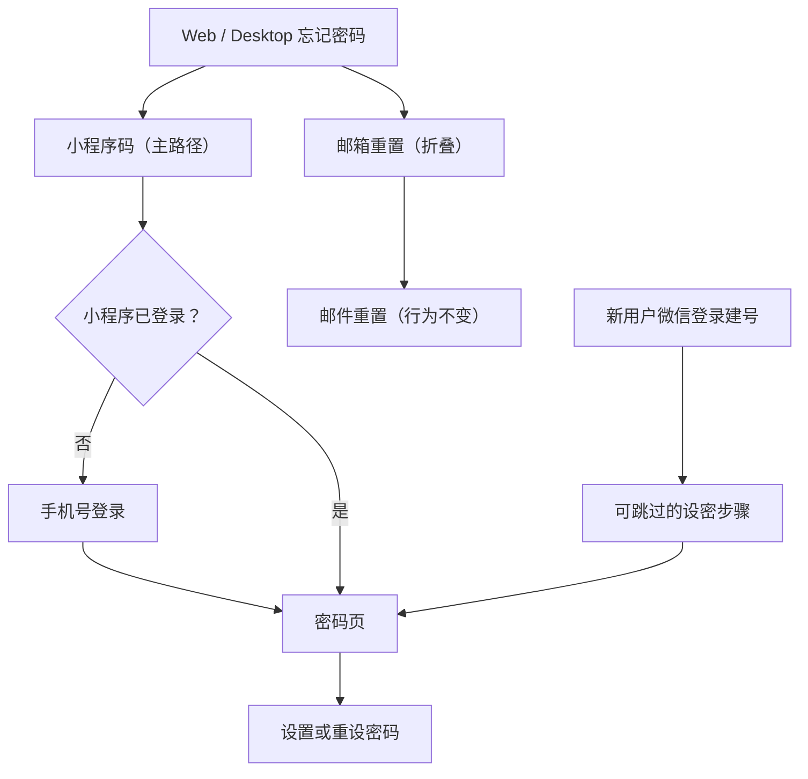

# 小程序密码中心与账号找回 - Plan

## Goal Capsule

- **Objective:** 微信与手机号建号的用户拥有一份不依赖微信的登录凭证，可在 Web 与 Desktop 用手机号加密码登录；忘记密码不再只有邮箱一条路。
- **Means:** 在小程序内完成密码的设置与重设，并把 Web 与 Desktop 的忘记密码入口改为小程序优先。
- **Product authority:** 本计划只覆盖密码设置/重设与入口分流。账号合并、短信通道、注册强制设密不在本次范围。
- **Open blockers:** 含密码页的小程序版本必须先审核发布，Web 与 Desktop 入口才能上线；历史邮箱账号仍依赖邮件可达性（#216 未验收）。

## Product Contract

### Summary

小程序成为密码管理中心：微信或手机号建号的用户在登录态下即可设置或重设密码，不需要邮箱、短信或旧密码。Web 与 Desktop 的忘记密码页改为小程序优先，邮箱重置折叠保留给历史账号。

### Problem Frame

平台新用户通过微信手机号授权建号，账号的 `email` 与密码哈希都为空，微信是唯一凭证。一旦微信或手机号失效，账号与数据永久失联。

现有「忘记密码」只接受邮箱，这批用户既没有邮箱也没有密码，自助路径是断的。Desktop 的忘记密码虽然存在，但它进入客户端内的重置模式，同样依赖邮件里的凭证。结果是：唯一能自救的是历史邮箱用户，而增长最快的用户群没有任何兜底。

### Key Decisions

- **小程序是密码管理中心，Web 与 Desktop 只消费密码。** 小程序登录态由微信保证，是唯一无需邮箱或短信就能完成身份确认的场所。Governs R1, R5, R6.
- **注册时设密可选，不强制。** 新用户首访目标是内容与报名，强制设密会打断转化。session-settled: user-approved — chosen over 注册强制设密: 新用户当下要的不是电脑登录。Governs R4.
- **修改密码不要求旧密码，但「修改」与「忘记重设」分成两个动作。** 无邮箱、无短信时，旧密码是唯一会卡住用户的校验。session-settled: user-approved — chosen over 统一要求旧密码: 忘记密码的用户正是记不住旧密码的人。Governs R2.
- **密码页展示掩码手机号与账号标识。** 用户到 Web 登录时必须知道该输哪个手机号。session-settled: user-approved — chosen over 只显示成员编号: 成员编号不能用来登录。Governs R3.
- **Web 忘记密码页小程序优先，邮箱折叠。** 新体系用户是多数；历史邮箱用户仍可一键切到邮箱路径。Governs R7, R8.
- **小程序码使用固定 scene，不每次动态生成。** scene 只决定落地页，不携带凭证，动态化不提升安全性，反而增加对外部接口与额度的依赖。Governs R9.
- **新增登录态设密能力，现有邮件重置行为不动。** 邮件重置需要吊销全部会话；设密需要保留当前会话。两者吊销范围不同，改现有行为是安全回退。Governs R11, R12.
- **历史邮箱账号保留邮件路径，不迁移到小程序。** 这类账号 `phone` 为空，小程序登录会按手机号新建账号。Governs R8, R12.

### Requirements

**小程序密码中心**

- R1. 已登录用户可在小程序内设置密码（当前无密码）或修改密码（当前有密码）。
- R2. 设置与修改都不要求输入旧密码；「忘记旧密码，直接重设」作为独立动作呈现。
- R3. 密码页展示掩码手机号与账号标识。
- R4. 微信手机号登录新建账号后，提供可跳过的设置密码步骤。
- R5. 设密成功后保留当前小程序会话，并使该用户其他端会话失效。
- R6. 密码强度规则与 Web 注册的现有规则一致。

**Web 与 Desktop 入口**

- R7. Web 忘记密码页以小程序为主路径，展示小程序码。
- R8. 邮箱重置收在次路径，入口文案明确「以前用邮箱注册过？」。
- R9. 小程序码使用固定 scene 参数，扫码直达小程序密码页。
- R10. 未登录用户扫码进入密码页时，先完成登录再回到密码页。
- R11. Desktop 的忘记密码入口改为打开 Web 忘记密码页，不再进入客户端内重置流程。

**兼容与观测**

- R12. 现有邮件重置行为不变，仍吊销该用户全部会话。
- R13. 设密成功与失败可按原因观测，供验收与支持排查。

### Key Flows

- F1. 新用户建号后设密
  - **Trigger:** 微信手机号登录创建了新账号。
  - **Steps:** 显示可跳过的设密步骤；用户设置密码或跳过；跳过后仍可从账号入口进入密码页。
  - **Outcome:** 账号拥有密码，Web 与 Desktop 可用手机号加密码登录。
  - **Covers:** R1, R4, R5, R6.
- F2. 忘记密码从 Web 扫码重设
  - **Trigger:** 用户在 Web 或 Desktop 点击忘记密码。
  - **Steps:** 页面展示小程序码；扫码进入密码页；未登录先完成手机号登录；设置新密码。
  - **Outcome:** 其他端会话失效，当前小程序会话保留。
  - **Covers:** R2, R5, R7, R9, R10.
- F3. 历史邮箱账号走邮箱重置
  - **Trigger:** 用户展开「以前用邮箱注册过？」。
  - **Steps:** 输入邮箱；收到重置邮件；用邮件里的凭证设置新密码。
  - **Outcome:** 行为与现状一致。
  - **Covers:** R8, R12.

### Acceptance Examples

- AE1. 新用户设密后登录 Web
  - **Covers R1, R4, R6.**
  - **Given:** 用户首次通过微信手机号登录，账号无邮箱、无密码。
  - **When:** 在设密步骤输入符合规则的新密码并提交，随后在 Web 用手机号加密码登录。
  - **Then:** 登录成功。
- AE2. 跳过设密后仍可补设
  - **Covers R4, R5.**
  - **Given:** 新用户在建号时跳过了设密。
  - **When:** 之后从「我的」进入密码页设置密码。
  - **Then:** 设置成功，当前小程序会话保持有效。
- AE3. 忘记旧密码直接重设
  - **Covers R2, R5.**
  - **Given:** 用户已设过密码，但记不住。
  - **When:** 选择「忘记旧密码，直接重设」并提交新密码。
  - **Then:** 新密码生效，其他端会话失效，当前会话保留。
- AE4. 未登录扫码进入密码页
  - **Covers R10.**
  - **Given:** 用户在小程序未登录状态下扫了忘记密码页的码。
  - **When:** 完成手机号登录。
  - **Then:** 落在密码页，而不是小程序首页。
- AE5. 历史邮箱账号不被带偏
  - **Covers R8, R12.**
  - **Given:** 账号 `phone` 为空，只有邮箱。
  - **When:** 用户在忘记密码页选择「以前用邮箱注册过？」。
  - **Then:** 走邮件重置，不进入小程序设密流程。

### Success Criteria

- 无密码账号能在小程序完成设密，随后在 Web 与 Desktop 用手机号加密码登录成功。
- 设密成功率与失败原因可按原因观测。
- 邮件重置路径无回归：行为、会话吊销范围与现状一致。

### Scope Boundaries

- 不做账号合并，不做多身份归一。
- 不修复短信通道，不引入短信验证码重置。
- 不做注册时强制设密。
- 不修改隐私声明：现有声明已覆盖密码哈希与身份验证，新增设密入口不改变收集的数据种类与用途。
- 不做「账号安全中心」扩展：绑定邮箱、换绑手机号、设备会话列表。
- 不新增 re-auth 或 step-up 机制；小程序登录态即凭证。

### Dependencies / Assumptions

- 小程序码指向已发布页面，小程序新版本必须先于 Web 与 Desktop 入口上线。
- 手机号加密码登录链路已存在，设密后无需新增登录入口。
- 历史邮箱账号 `phone` 为空时，小程序登录会按手机号新建账号；这是保留邮箱路径的原因。

### Outstanding Questions

**Deferred to Planning**

- 密码强度的具体阈值与错误文案。
- 设密接口的限流参数。
- 「其他端会话失效」的判定与实现形态。
- 固定 scene 码的存放位置与多环境配置。
- Desktop 打开 Web 时携带的语言与来源参数。

### Sources / Research

- `backend/lib/cgc_2046/accounts/user.ex`：`email` 与 `hashed_password` 可空；邮件重置的资源级吊销只匹配重置动作。
- `backend/lib/cgc_2046/accounts/strategies/miniprogram.ex`：小程序建号以手机号为锚。
- `backend/lib/cgc_2046_web/graphql_schema/auth/helpers.ex`：`login` 不含 `@` 时走手机号加密码。
- `backend/lib/cgc_2046/integrations/wechat/web_login_launch.ex`：小程序码与 URL Link 的现有生成方式。
- `desktop/crates/app/src/root_view/screens/auth.rs`：Desktop 忘记密码现状为客户端内重置。
- `desktop/crates/app/src/settings_window.rs`：`open_url` 已有先例。
- `miniprogram/src/pages/profile/index.tsx`：账号标识现状与入口分组。
- `web/app/[locale]/(auth)/forgot-password/page.tsx`：Web 忘记密码页现状只接受邮箱。
- #216（SendCloud 邮件前置检查单，未验收）、#249（SMS 建号用户缺兜底，已关闭）、#1033（Web 微信统一入口）。

## Planning Contract

### KTD1. 设密是独立 action，复用「吊销全部 + 补发当前」而不是排除当前 jti

新增登录态 `set_password` action：写哈希、吊销该用户全部已存 token，resolver 成功后立即签发新 token 并写回 cookie。邮件重置的 action 与吊销范围保持不变。

- 排除 jti 需要从请求解析并比对当前 token，多一条出错路径；「吊销全部再补发」用户无感且不需要解析。
- 吊销挂在 action 的 after_action 内，失败冒泡回滚（与邮件重置同语义）。
- 哈希写入复用 `HashPasswordChange`（`strategy_name: :password`），长度约束 8 位与注册一致。

### KTD2. `hasPassword` 只作为布尔透出，不把哈希暴露到 GraphQL

`signInWithPlatform` / `signInWithPlatformIdentity` 返回 `hasPassword`，用于登录后提示可跳过的设密步骤。`hashed_password` 仍为 `sensitive?: true, public?: false`。

### KTD3. 固定 scene 小程序码 + 进程内缓存 + 失败降级

`getwxacodeunlimit(page: 密码页, scene: "pw", check_path: true)`，成功结果存 `:persistent_term`（码固定、无凭证）。微信侧未发布或接口失败返回 `null`，Web 展示文字引导，不阻塞页面。

### KTD4. Desktop 只做跳转，不复制找回 UI

`forgot_password_url/0` 从 API 端点推导站点地址：官方域去掉 `api.` 前缀，本地回退 `http://localhost:3000`。Desktop 的 `LoginMode::Reset` 保留但不再是入口（避免牵连 controller 与表单状态机）。

### KTD5. 隐私声明不改

现有声明已覆盖密码哈希与身份验证；新增设密入口不改变收集的数据种类与用途。小程序仍需发一次版（新页面无法热更新）。

## Implementation Units

### U1. 后端：登录态设密能力

- Goal: 已登录用户可设置/重设密码，成功后其他端会话失效。
- Files: `backend/lib/cgc_2046/accounts/user.ex`、`backend/lib/cgc_2046_web/graphql_schema/auth.ex`、`backend/lib/cgc_2046_web/graphql_schema/auth/types.ex`
- Patterns: 沿用 `update_phone` 的本人写接口与 `with_actor` 门控；错误映射走 `to_ash_graphql_errors`。
- Tests: `backend/test/cgc_2046_web/graphql_set_password_test.exs`（设置成功、旧 token 失效、手机号+新密码登录、短密码拒绝、未登录拒绝）。
- Verification: `mix test test/cgc_2046_web/graphql_set_password_test.exs`

### U2. 后端：登录返回设密状态

- Goal: 小程序能判断「该账号还没设过密码」。
- Files: 同 U1 的 `auth.ex` / `types.ex`。
- Tests: 既有平台登录测试补断言 `hasPassword`。

### U3. 小程序：密码中心页与入口

- Goal: 我的 → 账号与安全 → 登录密码；设置/重设免旧密码；展示掩码手机号；新账号登录后一次可跳过提示。
- Files: `miniprogram/src/pages/account-password/`、`miniprogram/src/domain/password-center.ts`、`miniprogram/src/pages/profile/index.tsx`、`miniprogram/src/pages/login/index.tsx`、`miniprogram/src/domain/platform-pages.ts`、`miniprogram/src/api/*`、`miniprogram/src/domain/models.ts`
- Patterns: 页面逻辑下沉 domain（无页面渲染测试）；`captureAuthCookie` 接住换发的新 token。
- Tests: `miniprogram/tests/password-center.test.ts`
- Verification: `node --experimental-strip-types --test tests/password-center.test.ts` + `./node_modules/.bin/tsc --noEmit`

### U4. Web：忘记密码页小程序优先

- Goal: 默认展示小程序码，邮箱重置折叠并明确标注「以前用邮箱注册过？」。
- Files: `web/app/[locale]/(auth)/forgot-password/page.tsx`、`web/lib/graphql/auth.ts`、`web/messages/{zh-CN,en}.json`、`backend/lib/cgc_2046_web/graphql_schema.ex`、`backend/lib/cgc_2046/integrations/wechat/web_login_launch.ex`
- Tests: `web/app/[locale]/(auth)/forgot-password/page.test.tsx`
- Verification: `./node_modules/.bin/vitest run "app/[locale]/(auth)/forgot-password/page.test.tsx"`

### U5. Desktop：忘记密码跳 Web

- Goal: 客户端不再走应用内 token 重置，直接打开 Web 找回页。
- Files: `desktop/crates/app/src/root_view/screens/auth.rs`、`desktop/crates/platform/src/runtime.rs`
- Tests: `runtime::tests::forgot_password_url_maps_api_host_to_site`
- Verification: `cargo test -p cgc-platform runtime::tests::forgot --lib`

## Verification Contract

| 层 | 命令 | 覆盖 |
| --- | --- | --- |
| 后端 | `mix test test/cgc_2046_web/graphql_set_password_test.exs` | U1、U2 |
| 小程序 | `node --experimental-strip-types --test tests/password-center.test.ts` | U3 判据与文案 |
| 小程序 | `./node_modules/.bin/tsc --noEmit` | U3 类型与契约 |
| Web | `./node_modules/.bin/vitest run "app/[locale]/(auth)/forgot-password/page.test.tsx"` | U4 |
| Desktop | `cargo test -p cgc-platform runtime::tests::forgot --lib` | U5 |

## Definition of Done

- 无密码账号在小程序设置密码后，Web 与 Desktop 可用手机号 + 新密码登录。
- 设密后旧会话失效，当前会话无需重新登录。
- Web 忘记密码页默认展示小程序码；生成失败时降级文案可用；邮箱折叠路径行为不变。
- 微信手机号登录返回 `hasPassword`，新账号登录后出现一次可跳过的设密提示。
- Desktop 忘记密码打开 Web 找回页。
- 邮件重置的现有测试无回归。

